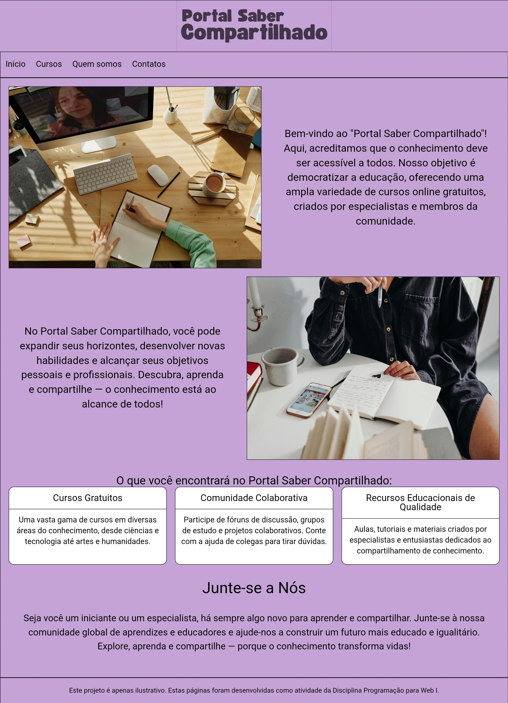

# 🎓 Online Course Platform

Uma interface web desenvolvida para representar uma plataforma de cursos online.

## 📌 Sobre

Este projeto foi desenvolvido individualmente durante a disciplina de Desenvolvimento Web I, no curso Técnico em Informática do Instituto Federal do Ceará (IFCE).

A proposta consistiu na criação de um site para uma plataforma de cursos, explorando a estruturação de páginas e a apresentação de conteúdos educacionais em uma interface web.

## 🖥️ Preview

## ✨ Funcionalidades e elementos

- Apresentação de uma plataforma de cursos online.
- Organização visual de conteúdos educacionais.
- Interface para navegação entre as seções do site.

## 🛠️ Tecnologias utilizadas

- HTML5
- CSS3

## 📚 Aprendizados

- Estruturação de páginas com HTML.
- Estilização de interfaces com CSS.
- Organização de conteúdo em páginas web.
- Desenvolvimento de interfaces a partir de uma proposta acadêmica.

## 🎯 Contexto acadêmico

- Instituição: IFCE 
- Curso: Técnico em Informática 
- Disciplina: Desenvolvimento Web I
- Modalidade: Individual

## 🌐 Acesse o projeto

🔗 Site: https://esthefanysouza.github.io/Online-Course-Platform/index.html
💻 Código: https://github.com/esthefanysouza/Online-Course-Platform/tree/main

## 👩‍💻 Autoria
Desenvolvido por Esthefany Souza.
